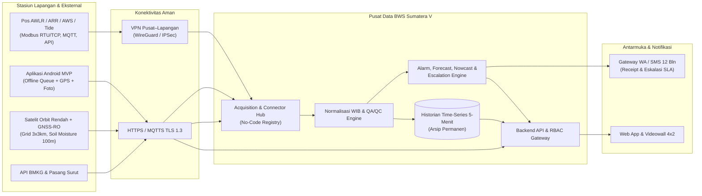

# Product Requirements Document (PRD)
## Platform Pemantauan Data Sumber Daya Air (SDA), Prakiraan Cuaca Satelit, Peringatan Dini Banjir (EWS), dan Respons Bencana — BWS Sumatera V

| Atribut Dokumen | Detail |
| :--- | :--- |
| **Nama Produk** | SIH3 & EWS Terpadu BWS Sumatera V (Platform Tata Air & Peringatan Dini Banjir Sumatera Barat) |
| **Instansi Pemilik** | Balai Wilayah Sungai (BWS) Sumatera V — Direktorat Jenderal Sumber Daya Air, Kementerian PUPR |
| **Cakupan Wilayah** | Wilayah Kerja BWS Sumatera V (Provinsi Sumatera Barat: WS Indragiri–Akuaman, WS Rokan, WS Kampar, WS Batanghari, dan WS Silaut–Tarusan serta DAS Kuranji, Arau, Anai) |
| **Versi Dokumen** | 1.0 (Baseline Spesifikasi Teknis Lengkap) |
| **Tanggal** | 25 November 2026 |
| **Status** | Siap Implementasi & Validasi Demo Interaktif |

---

## 1. Ringkasan Eksekutif & Tujuan Produk

### 1.1 Latar Belakang
Wilayah kerja **BWS Sumatera V (Provinsi Sumatera Barat)** memiliki karakteristik topografi curam di kawasan Bukit Barisan dengan sungai-sungai bergradien tinggi (seperti *Batang Kuranji*, *Batang Arau*, *Batang Anai*, dan *Batang Tarusan*) yang bermuara langsung ke Samudra Hindia. Kondisi ini menyebabkan waktu konsentrasi banjir (*time of concentration*) yang sangat singkat, diperparah oleh potensi banjir bandang (*galodo*), hujan ekstrem lokal, dan koinsidensi pasang laut (*compound flood*) di wilayah pesisir Kota Padang dan Padang Pariaman.

Di sisi lain, data pos hidrologi (AWLR, ARR, AWS, Pos Duga Pasang Surut), data prakiraan cuaca BMKG, prakiraan satelit resolusi tinggi, hasil survei penampang sungai, serta koordinasi lapangan antara **BWS – BPBD – Pemda** seringkali tersebar di sistem yang terpisah.

### 1.2 Tujuan Produk
Membangun satu platform berbasis web dan aplikasi mobile lapangan (Android MVP) yang terintegrasi penuh untuk:
1. **Akuisisi & Normalisasi Data Telemetri Lintas Protokol**: Mengumpulkan data pos baru dan pos eksisting (Modbus TCP/IP, Modbus RTU, MQTT, REST API, adaptor BMKG) melalui jaringan VPN pusat–lapangan dengan kendali mutu otomatis (*QA/QC*) dan arsip *time-series* 5-menitan permanen.
2. **Pemantauan Real-Time & Visualisasi Ruang Kendali**: Menyediakan *Master Dashboard Tata Air*, *Dashboard Banjir Siaga IV–I*, panel CCTV pos, serta tata letak khusus **Videowall 4×2** (preset Normal & Siaga).
3. **Prakiraan Cuaca Satelit Orbit Rendah (LEO + GNSS-RO) & Nowcasting**: Mengintegrasikan prakiraan resolusi tinggi `3 × 3 km` (144 jam / 42 parameter), *soil moisture* `100 × 100 m`, koreksi bias *nowcasting* 0–6 jam dengan pos ARR/AWS, serta prediksi waktu eskalasi banjir dan koinsidensi hujan–pasang muara.
4. **Pembaruan Data Badan Sungai & Lengkung Debit**: Memfasilitasi surveyor untuk mengunggah penampang sungai, topografi, dan foto drone dengan validasi koordinat serta pembaruan ambang batas dan *rating curve* secara terkontrol.
5. **Respons Bencana, Evakuasi & Aplikasi Lapangan Android**: Mendigitalisasi SOP mitigasi lintas instansi (BWS–BPBD–Pemda), peta jalur & titik kumpul evakuasi per kelurahan, saran tindakan pra/saat/pasca bencana, serta aplikasi Android petugas pos dengan dukungan mode *offline* dan sinkronisasi.
6. **Mesin Alarm & Gateway Notifikasi WA/SMS Berjenjang (12 Bulan)**: Menjamin peringatan dini hidrologi, teknis pos, dan cuaca ekstrem tersampaikan sesuai zona dan peran dengan tanda terima baca serta eskalasi otomatis bila tidak direspons.

### 1.3 Ketentuan Umum Pengadaan (Bagian A PDF)
Seluruh perangkat keras, perangkat lunak, dan layanan yang ditawarkan wajib:
- Memenuhi spesifikasi teknis minimum yang ditetapkan pada Bagian B (Item 1–8).
- Dilengkapi spesifikasi pabrikan (brosur/katalog resmi), *manual book* operasional dan pemeliharaan, serta **garansi resmi purnajual**.

---

## 2. Matriks Keterlacakan Spesifikasi (Traceability Matrix)

Tabel berikut memetakan 100% butir spesifikasi dari dokumen PDF (Bagian A & Bagian B Item 1–8) ke modul fungsional platform.

| No | Item Spesifikasi (PDF) | Sub-Komponen / Parameter | Kebutuhan Spesifikasi Teknis Minimum | Modul Target di Platform |
| :--- | :--- | :--- | :--- | :--- |
| **A** | **Spesifikasi Umum** | Kelengkapan & Garansi | Brosur/katalog pabrikan, manual book, garansi resmi purnajual | Modul 9 (Dokumentasi & Purnajual) |
| **1.1** | **Platform pemantauan & data SDA** | Antarmuka | Web GUI (Windows/Linux), daring real-time format tabular, grafis, skema/peta | Semua Modul Web + Master Dashboard |
| **1.2** | | Data real-time pos | Status komunikasi pos, muka air (`m` dan `+mdpl`), fluktuasi muka air, curah hujan terukur | Modul 1, Modul 2, Modul 3 |
| **1.3** | | Data historis | Analisis historis, pilih periode, laporan harian/mingguan/bulanan/tahunan, tren jam (rata-rata, puncak), hari, bulan, tahun, min/max per 24 jam | Modul 3 (Historian & Laporan) |
| **1.4** | | Pelaporan dan ekspor | Ekspor laporan ke Excel/PDF dan data ke CSV; impor CSV dari aplikasi pihak ketiga | Modul 3 (Ekspor & Impor) |
| **1.5** | | Alarm | Alarm ambang yang dapat ditentukan pengguna per parameter; ubah interval & nilai ambang secara daring | Modul 8 (Alarm & Notifikasi) |
| **1.6** | | Komunikasi | Akuisisi Modbus TCP/IP, Modbus RTU, MQTT, API; dukungan VPN pusat–lapangan; cek status komunikasi otomatis | Modul 4 (Telemetri & Server) |
| **1.7** | | Master Dashboard Tata Air SDA BWS Sumatera V | Peta seluruh pos & aset warna status, ringkasan per DAS & WS, panel CCTV & grafik ringkas, manajemen pengguna & RBAC (operator, pimpinan, BPBD, petugas), videowall 4×2 (preset normal & siaga), pencarian pos & log akses | Modul 1 & Modul 9 (Settings/RBAC) |
| **1.8** | | Dashboard Banjir | Status Siaga IV–I otomatis dari ambang, skema DAS hulu–hilir, grafik muka air & hujan, prediksi waktu eskalasi, jejak audit status & ambang | Modul 2 (Dashboard Banjir) |
| **1.9** | | Kerangka integrasi data SDA eksisting | Konektor API, MQTT, Modbus pos baru & eksisting; adaptor BMKG; normalisasi satuan & zona waktu; QA/QC otomatis (out-of-range, data beku); daftar pos baru tanpa ubah kode | Modul 4 (Integrasi & QA/QC) |
| **1.10** | | Historian, alarm dan report engine | Basis data time-series 5 menitan arsip permanen; alarm pos mati, data hilang, baterai rendah; laporan harian/bulanan/kejadian (PDF/Excel); ekspor data kalibrasi model | Modul 3, Modul 4, Modul 8 |
| **1.11** | | Modul pembaruan data badan sungai dari surveyor | Unggah penampang, topografi, foto udara drone; validasi format & koordinat; riwayat versi per pos & tanggal; perbandingan perubahan alur; pembaruan ambang & lengkung debit (*rating curve*) | Modul 5 (Surveyor Badan Sungai) |
| **2.1** | **Modul prakiraan & peringatan dini** | Prakiraan cuaca satelit orbit rendah (12 bln) | Prakiraan hujan, angin, tekanan, siklon per jam min. 72 jam; agregasi sub-DAS; peta & animasi; perbandingan BMKG; simpan hasil olahan untuk model | Modul 6 (Prakiraan & Nowcast) |
| **2.2** | | Modul nowcasting | Koreksi bias prakiraan 0–6 jam dgn ARR/AWS tiap jam; peta nowcast per sub-DAS; skor akurasi terhadap data terukur | Modul 6 (Tab Nowcasting) |
| **2.3** | | Integrasi prakiraan & pola operasional banjir | Aturan peringatan berjenjang (outlook internal s.d. Siaga I); prediksi waktu eskalasi dgn rentang ketidakpastian; analisis koinsidensi hujan & pasang muara | Modul 2 & Modul 6 |
| **3** | **Langganan data prakiraan cuaca satelit 12 bln** | Layanan, Parameter, Soil Moisture, Integrasi | Satelit orbit rendah + GNSS-RO, akses API/dashboard 1 thn; grid 3×3 km, per jam, horizon 6 hari (144 jam), update 2×/hari, 42 parameter; hujan 1j/harian, suhu/embun/permukaan, angin (m/s & 0–360°), RH, radiasi matahari, tekanan, awan; *soil moisture* harian 100×100 m (`m³/m³` / `% VWC`); cakupan Sumbar (JSON/CSV/peta) + historis langganan; REST API otomatis + pemicu alarm cuaca ekstrem | Modul 6 & Modul 8 |
| **4.1** | **Modul respons bencana & aplikasi lapangan** | Modul SOP mitigasi bencana | SOP digital per status; daftar periksa & PIC; pembagian peran BWS–BPBD–Pemda; jejak pelaksanaan (siapa, kapan, apa); versi SOP disahkan | Modul 7 (Tab SOP Mitigasi) |
| **4.2** | | Modul pola & jalur evakuasi bencana | WebGIS jalur & titik kumpul; zona terdampak per status; data penduduk & fasilitas BPBD/Pemda; cetak peta evakuasi per kelurahan | Modul 7 (Tab Evakuasi) |
| **4.3** | | Modul saran & tindakan pra, saat, pasca | Rekomendasi berdasarkan status & prakiraan; templat tindakan pra/saat/pasca; log pelaksanaan; evaluasi pasca kejadian | Modul 7 (Tab Saran & Evaluasi) |
| **4.4** | | Aplikasi Android petugas pos hidrologi (MVP) | Data pos real-time; input bacaan manual, foto, lokasi GPS; notifikasi siaga; mode offline & sinkronisasi; konfirmasi tindakan SOP dari lapangan | Modul 7 (Tab Android MVP) |
| **5** | **Layanan notifikasi WA/SMS 12 bln** | Gateway notifikasi WA/SMS | Pesan berjenjang berbasis zona & peran; templat pesan per status; tanda terima pesan; eskalasi bila pesan tidak dibaca | Modul 8 (Gateway WA/SMS) |
| **6** | **Uji keamanan independen web & Android** | Uji keamanan aplikasi | Uji penetrasi (VAPT) web & Android oleh penguji independen; uji beban (*load test*); perbaikan temuan & uji ulang | Modul 4 (Keamanan) & Bagian 6 PRD |
| **7** | **Lokakarya / FGD tenaga ahli (3 kali)** | 3× Lokakarya/FGD | 3 lokakarya (ambang, SOP, pola evakuasi); 5 ahli/sesi; notulensi & rekomendasi tertulis | Bagian 7 PRD |
| **8** | **Implementasi, pelatihan, pendampingan, serah terima** | Commissioning, TOT, Dokumentasi | Commissioning & SAT; pelatihan TOT (calon instruktur, operator, petugas pos); as-built & manual O&P; mobilisasi & pendampingan; sertifikat instruktur | Bagian 7 PRD |

---

## 3. Persona Pengguna & Kontrol Akses Berbasis Peran (RBAC)

| Peran (*Role*) | Deskripsi Tugas | Hak Akses Utama |
| :--- | :--- | :--- |
| **Operator Pusat Kendali** | Memantau pos 24/7 di Ruang Komando BWS Sumatera V, memvalidasi anomali telemetri, mengoperasikan Videowall 4×2, mengelola alarm awal. | Baca seluruh data, *acknowledge/resolve* alarm, uji kirim WA/SMS, ubah preset videowall, unggah/impor data CSV. |
| **Pimpinan BWS** | Kepala Balai / Kasie OP / PPK yang mengambil keputusan penetapan status Siaga I, pengesahan versi SOP, dan menerima eskalasi kritis. | Baca penuh seluruh dasbor, *approve* versi SOP & pembaruan ambang, terima eskalasi SLA WA/SMS, lihat audit log. |
| **BPBD / Pemda** | Tim Pusdalops BPBD Provinsi/Kabupaten/Kota & Pemerintah Daerah terkait evakuasi dan posko pengungsian. | Baca Dashboard Banjir, WebGIS Evakuasi, cetak peta kelurahan, eksekusi item SOP peran BPBD/Pemda, terima notifikasi WA/SMS zona terdampak. |
| **Petugas Pos Lapangan** | Pengamat pos AWLR/ARR/AWS di lapangan menggunakan aplikasi Android MVP. | Baca pos tugasnya, kirim bacaan manual + foto + GPS (online/offline sync), konfirmasi tindakan SOP lapangan. |
| **Surveyor Hidrometri** | Tim pengukuran penampang sungai (*cross-section*), topografi, drone orthophoto, dan kalibrasi lengkung debit. | Unggah & validasi berkas survei, bandingkan perubahan alur, ajukan pembaruan ambang & parameter *rating curve*. |
| **Admin Sistem** | Pengelola infrastruktur server, VPN pusat–lapangan, konektor telemetri, manajemen akun RBAC, dan audit keamanan. | CRUD pengguna & peran, daftar pos baru *no-code*, konfigurasi konektor/VPN/ambang daring, unduh audit akses & keamanan. |

---

## 4. Spesifikasi Fungsional Rinci per Modul

### 4.1 Modul 1 — Master Dashboard Tata Air SDA BWS Sumatera V
- **Peta Interaktif WebGIS**: Menampilkan seluruh pos (AWLR, ARR, AWS, Pos Pasang Surut) dan aset infrastruktur SDA (bendung, tanggul, pintu air, kolam retensi) dengan pewarnaan status (*Normal* hijau, *Siaga IV* biru, *Siaga III* kuning, *Siaga II* oranye, *Siaga I* merah berkedip, *Offline* abu-abu).
- **Ringkasan Status per DAS & Wilayah Sungai (WS)**: Kartu agregasi status per WS/DAS (mis. DAS Batang Kuranji, Batang Arau, Batang Anai, Batang Agam, Batang Hari Hulu, Batang Tarusan).
- **Panel CCTV Pos & Grafik Ringkas**: Pemantauan visual kondisi sungai/mistar duga real-time dilengkapi HUD elevasi TMA, timestamp WIB, kontrol *pan/tilt/zoom* (PTZ), dan *sparkline* hidrograf 6 jam.
- **Pencarian Pos & Log Akses Pengguna**: Pencarian cepat berdasarkan nama pos, kode, DAS, atau status; serta pencatatan log login, perubahan konfigurasi, dan akses modul.
- **Mode Videowall 4×2**: Tampilan *full-screen* grid `4 kolom × 2 baris` (8 panel simultan) tanpa distraksi navigasi dengan dua preset:
  - **Preset Normal**: Peta Pos & Aset, Ringkasan DAS/WS, 4 Panel CCTV Utama, Peta Hujan Satelit, Kesehatan Server & VPN.
  - **Preset Siaga**: Peta Zona Banjir & Evakuasi, Skema Hulu–Hilir DAS Kritis, Prediksi Waktu Eskalasi, Hidrograf Kritis, Antrean Alarm Aktif, Log Pengiriman/Eskalasi WA/SMS, Progres Checklist SOP, CCTV Titik Kritis.

### 4.2 Modul 2 — Dashboard Banjir & Peringatan Dini
- **Status Siaga IV–I Otomatis**: Kenaikan atau penurunan status Siaga IV, III, II, dan I dihitung otomatis oleh *rule engine* berdasarkan perbandingan TMA aktual terhadap ambang batas masing-masing pos.
- **Skema DAS Hulu–Hilir**: Diagram topologi aliran sungai (*node-link*) yang menghubungkan pos hujan hulu (ARR) → pos duga air tengah → pos duga air hilir → pos pasang surut muara, lengkap dengan estimasi waktu tempuh gelombang banjir (*travel time*).
- **Grafik Gabungan Muka Air & Hujan**: *Hyetograph* curah hujan terbalik di bagian atas dipadukan dengan *Hydrograph* TMA (`m` & `+mdpl`), garis putus-putus ambang Siaga IV–I, serta pita proyeksi prakiraan 6 jam.
- **Prediksi Waktu Eskalasi**: Menampilkan estimasi waktu tercapainya level Siaga berikutnya beserta **rentang ketidakpastian** (misal: *"Siaga II dalam 1 jam 45 mnt ± 25 mnt"*).
- **Jejak Audit Perubahan Status & Ambang**: Rekaman *immutable* setiap perubahan status otomatis/manual dan modifikasi nilai ambang (waktu, aktor, nilai lama → baru, alasan).

### 4.3 Modul 3 — Data Real-Time, Historian 5-Menitan & Pelaporan
- **Data Real-Time Pos**: Status komunikasi, TMA lokal (`m`), elevasi absolut (`+mdpl`), fluktuasi muka air ($\Delta h$ per jam), curah hujan terukur (`mm/jam` & akumulasi 24j), tegangan baterai, dan kekuatan sinyal.
- **Basis Data Time-Series 5 Menitan**: Penyimpanan historis resolusi 5 menit dengan arsip permanen (*TimescaleDB / partitioning* jangka panjang).
- **Analisis Historis & Tren**: Pemilihan rentang tanggal fleksibel; agregasi **Harian, Mingguan, Bulanan, Tahunan**; tren per jam (**rata-rata & puncak**); serta ringkasan nilai **Maksimum & Minimum per 24 jam**.
- **Pelaporan, Ekspor & Impor**:
  - Ekspor laporan terformat ke **Excel (.xls/.xlsx)** dan **PDF** (harian, bulanan, dan per kejadian banjir).
  - Ekspor data mentah ke **CSV** serta ekspor dataset terstruktur untuk **kalibrasi model hidrologi/hidrolika** (JSON/CSV).
  - **Impor CSV dari Aplikasi Pihak Ketiga**: Antarmuka unggah CSV dengan pemetaan kolom, validasi timestamp & satuan, serta pratinjau sebelum masuk ke basis data historian.

### 4.4 Modul 4 — Kerangka Integrasi Telemetri, QA/QC & Server
- **Konektor Akuisisi Multi-Protokol**: Dukungan penuh untuk pos baru maupun pos eksisting melalui **Modbus TCP/IP**, **Modbus RTU (Serial/RS-485)**, **MQTT Broker (TLS)**, dan **REST API/Webhook**, serta **Adaptor Data BMKG** (cuaca & peringatan dini maritim/pasang).
- **Jaringan VPN Pusat–Lapangan**: Monitoring status *tunnel* VPN (WireGuard/IPSec) dari setiap stasiun/RTU ke server pusat, latensi (`ms`), *packet loss*, dan pengecekan status komunikasi (*heartbeat*) otomatis.
- **Normalisasi & Kendali Mutu Data Otomatis (QA/QC)**:
  - Konversi otomatis ke zona waktu standar **WIB (UTC+7)** dan satuan baku (`m`, `+mdpl`, `mm`, `m³/s`).
  - Deteksi otomatis anomali: **Nilai di Luar Rentang (*Out-of-Range*)**, **Data Beku (*Frozen/Flatline*)**, dan **Data Hilang (*Missing Gap*)**.
- **Pendaftaran Pos Baru Tanpa Mengubah Kode (*No-Code Onboarding*)**: Wizard konfigurasi untuk menambah stasiun baru (metadata, koordinat, protokol, *register Modbus / topic MQTT / endpoint API*, serta ambang Siaga) yang langsung aktif di peta, tabel, dan *alarm engine*.

### 4.5 Modul 5 — Pembaruan Data Badan Sungai dari Surveyor
- **Unggah Data Survei Lapangan**: Mendukung unggah hasil pengukuran **penampang melintang (*cross-section*)**, **topografi memanjang**, dan **foto udara drone (*orthophoto/DEM*)**.
- **Validasi Format & Koordinat**: Pemeriksaan otomatis format berkas (CSV/GeoJSON/DXF/GeoTIFF) dan sistem proyeksi koordinat (WGS84 / UTM Zona 47S untuk Sumatera Barat) sebelum tersimpan.
- **Riwayat Versi & Perbandingan Perubahan Alur**: Versioning per pos dan per tanggal survei disertai grafik tumpang-susun (*overlay*) untuk mendeteksi pendangkalan (sedimentasi) atau gerusan (*scouring*).
- **Pembaruan Ambang & Lengkung Debit (*Rating Curve*)**: Kalkulator dan editor kurva debit $Q = a(H - H_0)^b$ berdasarkan data kalibrasi pengukuran debit terbaru, serta sinkronisasi nilai ambang Siaga ke *alarm engine*.

### 4.6 Modul 6 — Prakiraan Cuaca Satelit Orbit Rendah (12 Bulan), Nowcasting & Operasional Banjir
- **Langganan & Integrasi Data Satelit Orbit Rendah + GNSS-RO (12 Bulan)**:
  - Akses otomatis melalui REST API dan dashboard web selama masa berlangganan 1 tahun, mencakup seluruh wilayah kerja BWS Sumatera V (Provinsi Sumatera Barat) dalam format JSON, CSV, dan visualisasi peta, beserta akses arsip historis selama masa kontrak.
  - **Resolusi & Horizon**: Grid spasial `3 × 3 km` (±3 km), interval per jam, horizon **6 hari (144 jam)** (memenuhi dan melampaui syarat minimum 72 jam pada Modul 2), pembaruan **2× sehari**, mencakup **42 parameter meteorologis** pada berbagai ketinggian atmosfer.
  - **Parameter Utama**: Curah hujan akumulasi 1 jam (`mm/jam`) & harian (`mm/hari`), suhu udara/titik embun/permukaan tanah (`°C`), kecepatan (`m/s`) & arah angin (`0°–360°`), kelembapan relatif (`%`), radiasi matahari (`W/m²`), tekanan udara permukaan (`hPa`), tutupan awan (`%`), serta deteksi potensi siklon/badai tropis.
  - **Kelembapan Tanah (*Soil Moisture Insight*)**: Resolusi harian `100 × 100 m` dalam satuan `m³/m³` atau `% VWC` sebagai indikator kejenuhan DAS sebelum hujan turun.
- **Agregasi Sub-DAS, Animasi & Perbandingan BMKG**: Peta prakiraan beranimasi per jam, agregasi hujan rata-rata wilayah (*areal rainfall*) per sub-DAS, perbandingan langsung dengan prakiraan BMKG, serta penyimpanan hasil olahan untuk masukan model hidrologi.
- **Modul Nowcasting (0–6 Jam)**: Koreksi bias prakiraan 0–6 jam setiap jam menggunakan data terukur pos ARR/AWS lokal, peta nowcast per sub-DAS, dan metrik skor akurasi (RMSE, MAE, Bias, CSI).
- **Integrasi Pola Operasional Banjir**:
  - Aturan peringatan berjenjang dari *Outlook Internal* hingga *Siaga I*.
  - Prediksi waktu eskalasi status disertai rentang ketidakpastian.
  - **Analisis Koinsidensi Hujan & Pasang di Muara**: Korelasi antara puncak banjir kiriman hulu (*Batang Arau / Batang Kuranji*) dengan puncak pasang laut (*Teluk Bayur*) untuk memitigasi banjir rob/genangan muara.

### 4.7 Modul 7 — Respons Bencana & Aplikasi Lapangan Android (MVP)
- **Modul SOP Mitigasi Bencana**:
  - SOP digital terstruktur per tingkat status (Normal, Siaga IV, Siaga III, Siaga II, Siaga I).
  - Daftar periksa (*checklist*) tugas dengan pembagian peran eksplisit antara **BWS – BPBD – Pemda** serta Penanggung Jawab (PIC).
  - Jejak pelaksanaan (*siapa, kapan, apa*) yang tercatat otomatis beserta penanda **Versi SOP yang Disahkan**.
- **Modul Pola & Jalur Evakuasi Bencana**:
  - WebGIS rute evakuasi, titik kumpul aman (*assembly point*), dan poligon zona terdampak per tingkat status Siaga.
  - Integrasi data jumlah penduduk rentan dan fasilitas vital (RS, sekolah, masjid, kantor camat) dari BPBD/Pemda.
  - Fitur **Cetak Peta Evakuasi per Kelurahan** dalam tata letak siap cetak/PDF.
- **Modul Saran & Tindakan Pra, Saat, dan Pasca Bencana**:
  - Rekomendasi tindakan otomatis berdasarkan status aktif dan prakiraan cuaca terkini.
  - Templat tindakan fase Pra-Bencana, Saat Bencana, dan Pasca-Bencana beserta log pelaksanaan dan formulir **Evaluasi Pasca Kejadian**.
- **Aplikasi Android Petugas Pos Hidrologi (MVP)**:
  - Akses data pos real-time di lapangan dan penerimaan *push notification* status Siaga.
  - Input pembacaan mistar duga manual (*staff gauge*), unggah foto kondisi sungai/alat, serta penandaan koordinat GPS otomatis.
  - **Mode Offline & Sinkronisasi**: Penyimpanan antrean data secara lokal saat jaringan seluler terputus dan sinkronisasi otomatis ke server pusat saat koneksi pulih.
  - Konfirmasi pelaksanaan tindakan SOP langsung dari lokasi pos.

### 4.8 Modul 8 — Alarm Engine & Layanan Notifikasi WA/SMS (12 Bulan)
- **Mesin Alarm Multi-Kategori**:
  1. *Alarm Hidrologi*: Kenaikan ambang Siaga IV–I atau laju kenaikan muka air ekstrem.
  2. *Alarm Teknis Pos*: Pos mati (*offline*), data hilang (*missing*), sensor beku/di luar rentang, baterai rendah (`< 11.8 V`).
  3. *Alarm Cuaca Ekstrem*: Pemicu otomatis dari prakiraan satelit (hujan lebat `> 20 mm/jam` atau angin kencang).
- **Konfigurasi Ambang & Interval Daring**: Operator/Admin berwenang dapat mengubah nilai ambang per parameter dan interval pembacaan pos langsung melalui web GUI dengan jejak audit.
- **Gateway Notifikasi WA/SMS (Langganan 12 Bulan)**:
  - Pengiriman pesan berjenjang berbasis **zona/DAS** dan **peran penerima**.
  - Templat pesan dinamis per status (mencantumkan nama pos, TMA, status Siaga, tren, dan instruksi singkat).
  - Pelacakan status pengiriman dan **Tanda Terima Baca (*Delivery & Read Receipt*)**.
  - **Eskalasi Otomatis**: Jika pesan kritis tidak dibaca atau dikonfirmasi melewati batas waktu SLA (mis. 5 menit), gateway otomatis melakukan eskalasi ke jenjang pimpinan/BPBD serta mengirimkan cadangan via **SMS Gateway**.

---

## 5. Arsitektur Teknis, Server & Keamanan

### 5.1 Arsitektur Sistem Terpadu

### 5.2 Kebutuhan Non-Fungsional & Infrastruktur Server
- **Ketersediaan (*Availability*)**: Target uptime platform ≥ 99,5% pada pusat kendali, dengan mekanisme *auto-reconnect* pada konektor telemetri dan *buffer* lokal di RTU/Android saat jaringan terganggu.
- **Kapasitas & Kinerja**: Mendukung akuisisi 5-menitan secara berkelanjutan untuk puluhan hingga ratusan pos, dengan waktu muat dasbor utama `< 2 detik` dan pembaruan status real-time `< 5 detik` setelah paket masuk.
- **Keamanan Sistem**:
  - Enkripsi data dalam transit (TLS 1.3 / VPN terowongan terenkripsi) dan *at-rest* untuk kredensial/token.
  - Autentikasi aman dengan RBAC granular serta pencatatan seluruh aktivitas (*audit trail* & *access log*).
  - Perlindungan terhadap kerentanan OWASP Top 10 (Web) dan OWASP MASVS (Android).

---

## 6. Uji Keamanan Independen (Web & Android)
Sesuai Spesifikasi Bagian B Item 6:
1. **Uji Penetrasi (*Penetration Testing / VAPT*)**: Dilakukan oleh penguji independen terhadap aplikasi Web (dashboard, API, autentikasi, upload surveyor) dan aplikasi Android petugas pos (MVP).
2. **Uji Beban (*Load & Stress Testing*)**: Menguji ketahanan sistem saat simulasi lonjakan pengiriman telemetri, akses bersamaan oleh ratusan pengguna/BPBD saat kejadian banjir, serta pengiriman massal notifikasi WA/SMS.
3. **Siklus Perbaikan & Uji Ulang (*Remediation & Retest*)**: Seluruh temuan kritis/tinggi wajib diperbaiki dan diverifikasi melalui uji ulang resmi sebelum serah terima (*commissioning*).

---

## 7. Tata Kelola Pelaksanaan: FGD, Implementasi, Pelatihan & Serah Terima

### 7.1 Lokakarya / FGD Tenaga Ahli (3 Kali — Item 7)
Dilaksanakan sebanyak **3 kali sesi terstruktur** dengan menghadirkan **5 narasumber ahli per sesi** (hidrologi, hidrolika/sungai, meteorologi, kebencanaan/BPBD, dan manajemen risiko/TI), menghasilkan **notulensi resmi dan rekomendasi tertulis** untuk:
1. **FGD 1 — Penetapan Ambang Batas Siaga IV–I & Lengkung Debit** tiap pos prioritas.
2. **FGD 2 — Penyusunan & Validasi SOP Mitigasi Bencana Digital** (pembagian peran BWS–BPBD–Pemda).
3. **FGD 3 — Penyusunan Pola & Jalur Evakuasi Bencana** serta skenario *compound flood* muara.

### 7.2 Implementasi, Pelatihan, Pendampingan & Serah Terima (Item 8)
- **Commissioning & Site Acceptance Test (SAT)**: Pengujian menyeluruh integrasi pos lapangan, server pusat, videowall 4×2, API satelit, aplikasi Android, dan gateway WA/SMS.
- **Pelatihan Metode *Training of Trainer (TOT)***:
  - Sasaran peserta: **Calon instruktur internal**, **operator pusat kendali**, dan **petugas pos lapangan**.
  - Materi: Pengoperasian dan pemeliharaan perangkat keras (RTU/sensor/catu daya) serta perangkat lunak (platform web, Android, kalibrasi ambang/rating curve).
  - Keluaran: **Sertifikat resmi** bagi peserta yang dinyatakan lulus dan kompeten menjadi instruktur perangkat dan sistem.
- **Dokumentasi & Pendampingan**: Penyerahan dokumen *As-Built*, *Manual Book* Pengoperasian & Pemeliharaan (O&P), mobilisasi tim, pendampingan operasional pasca-implementasi, serta dukungan garansi purnajual.

---

## 8. Indikator Keberhasilan (KPI)
| Indikator | Target |
| :--- | :--- |
| Ketercapaian akuisisi data pos telemetri eksisting & baru | ≥ 98% kelengkapan data per 24 jam |
| Waktu deteksi anomali sensor / pos mati | ≤ 15 menit (3 siklus 5-menitan) |
| Kecepatan distribusi peringatan WA/SMS setelah ambang terlewati | ≤ 30 detik |
| Tingkat keterbacaan & respons notifikasi Siaga (dengan eskalasi SLA) | 100% tertangani dalam ≤ 5 menit |
| Akurasi koreksi bias *nowcasting* 0–6 jam terhadap pos ARR/AWS | Peningkatan skor CSI / penurunan RMSE ≥ 20% dibanding data mentah |
| Kepatuhan hasil uji keamanan independen | 0 temuan *Critical/High* tersisa setelah uji ulang |
